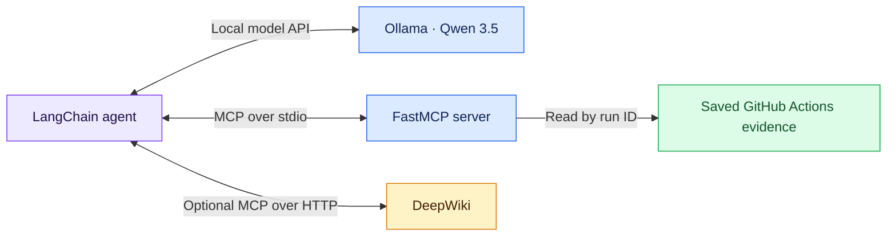

# 🔌 Local AI Agent with FastMCP

A Windows-friendly implementation of [Darsh Shah’s freeCodeCamp tutorial](https://www.freecodecamp.org/news/build-an-mcp-server-with-fastmcp-for-local-ai-agent/), with a read-only Build Release and Integration Engineering example. The default run uses your local Ollama model and needs no API key.



## 🟦 Run on Windows

Extract the ZIP and open PowerShell in the `local-agent-fastmcp` folder. Python 3.12 was used for the packaged checks.

```powershell
py -3.12 -m venv .venv
.\.venv\Scripts\python.exe -m pip install -r requirements.txt
.\.venv\Scripts\python.exe -m unittest discover -s tests -v
ollama list
.\.venv\Scripts\python.exe .\agent_with_mcp.py
```

Keep the Ollama app running. If `qwen3.5:4b` is absent from `ollama list`, run `ollama pull qwen3.5:4b`. The agent launches the MCP server automatically with the same Python interpreter. The direct tests need Python dependencies only.

## 🟩 Verify tool behavior

| Enter at the prompt | Check in the output |
|---|---|
| Count the words in “Cedar needs a smoke test.” | `word_count` returns 5 and the final answer agrees. |
| What time is it? | `current_time` returns a local timestamp with its UTC offset. |
| What is the capital of France? | Paris, with no tool call. |
| What do we know about CI run 21890541227? Cite the source. | `get_build_evidence` returns a failed validation job and the source URL. |
| Why did CI run 21890541227 fail? | The answer reports the observed failure and says the captured evidence cannot establish its cause. |
| What do we know about CI run 99999999999? | The tool returns `missing`, and the answer reports the evidence gap. |

Match each tool call to its result using the printed call ID. A correct final answer can still hide a skipped call or incorrect argument, so check the transcript as well.

## 🟨 Try the optional DeepWiki server

```powershell
.\.venv\Scripts\python.exe .\agent_with_mcp.py --deepwiki
```

Ask for a one-sentence overview of the public `karpathy/nanochat` repo. In this mode, remote tool arguments are sent to DeepWiki. Use public repo questions here. If remote discovery fails, the CLI reports the issue and starts with local tools.

## 🟪 Inspect the BRI evidence

The checked-in fixture comes from [Home Assistant BRI demo run 21890541227](https://github.com/anne500/home-assistant-bri-demo/actions/runs/21890541227). It records the run attempt, commit SHA, workflow and job conclusions, and artifact count returned by GitHub. The jobs response contained no step records. The saved metadata supports a failure finding, and establishing a cause would require further evidence.

| File | Purpose |
|---|---|
| `mcp_server.py` | Tool schemas and read-only fixture lookup. |
| `agent_with_mcp.py` | Local Ollama agent, optional remote discovery, and tool-call transcript. |
| `fixtures/home-assistant-run.json` | Saved GitHub Actions evidence with source URLs. |
| `tests/test_stdio.py` | Direct subprocess tests for tool discovery, results, and adapter integration. |
| `requirements.txt` | Dependency versions used for verification. |
