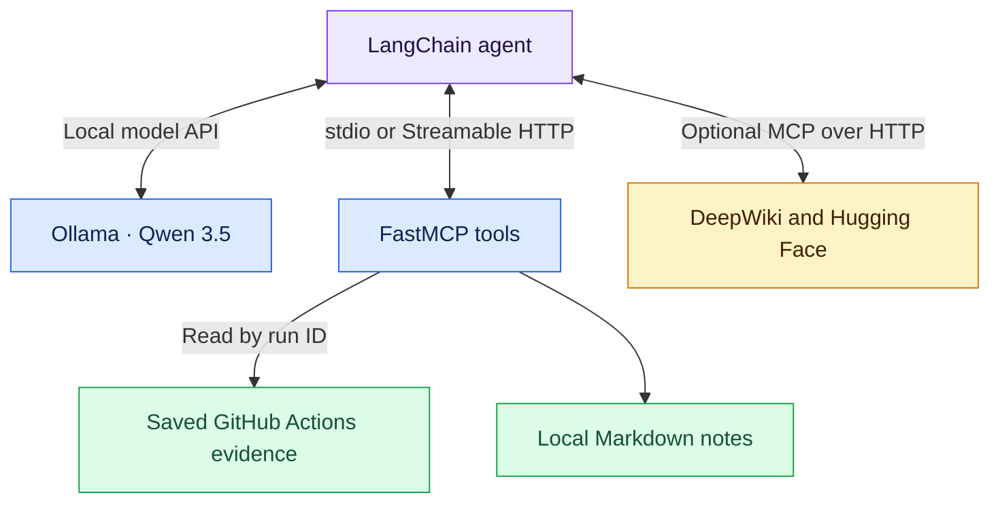
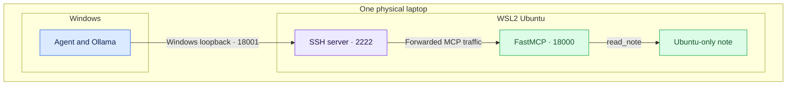
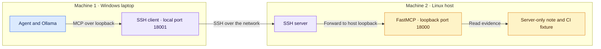

# 🔌 Local AI Agent with FastMCP

A Windows-friendly implementation of [Darsh Shah’s freeCodeCamp tutorial](https://www.freecodecamp.org/news/build-an-mcp-server-with-fastmcp-for-local-ai-agent/), with a read-only Build Release and Integration Engineering example. The default run uses your local Ollama model and needs no API key.



## 🟦 Run on Windows

Clone the repository or extract the ZIP, then open PowerShell in the `local-agent-fastmcp` folder. Python 3.12 was used for the packaged checks.

```powershell
py -3.12 -m venv .venv
.\.venv\Scripts\python.exe -m pip install -r requirements.txt
.\.venv\Scripts\python.exe -m unittest discover -s tests -v
ollama list
.\.venv\Scripts\python.exe .\agent_with_mcp.py
```

Keep the Ollama app running. If `qwen3.5:4b` is absent from `ollama list`, run `ollama pull qwen3.5:4b`. The agent launches the MCP server automatically with the same Python interpreter. The direct tests need Python dependencies only.

## 🟩 Verify tool behavior

| Enter at the prompt | Check in the output |
|---|---|
| Count the words in “Cedar needs a smoke test.” | `word_count` returns 5 and the final answer agrees. |
| What time is it? | `current_time` returns a local timestamp with its UTC offset. |
| What is the capital of France? | Paris, with no tool call. |
| What do we know about CI run 21890541227? Cite the source. | `get_build_evidence` returns a failed validation job and the source URL. |
| Why did CI run 21890541227 fail? | The answer reports the observed failure and says the captured evidence cannot establish its cause. |
| What do we know about CI run 99999999999? | The tool returns `missing`, and the answer reports the evidence gap. |

Match each tool call to its result using the printed call ID. A correct final answer can still hide a skipped call or incorrect argument, so check the transcript as well.

## 🟩 Extensions

🟢 **Verified hands-on** · 🟠 **Pending hardware**

| Extension | How to try it | Verification |
|---|---|---|
| 🟢 📝 **Local Markdown note reader** | Run the default agent and ask it to read the note named `cedar`. | On Windows, Qwen handled a missing note and quoted it after the file was created. Direct tests also checked path traversal. |
| 🟢 🌐 **DeepWiki** | Run the agent with `--deepwiki` and ask about `karpathy/nanochat`. | On Windows, the full-wiki call returned data but missed the one-sentence format. The focused `ask_wiki_question` call returned a result that Qwen summarized in one sentence. |
| 🟢 🤗 **Hugging Face MCP** | Run the agent with `--huggingface` and ask it to search the public Hub for `bert-base-uncased`. | With both public servers enabled on Windows, Qwen called `hub_repo_search` with a model filter and limit of one, then returned `google-bert/bert-base-uncased`. |
| 🟢 🔌 **Streamable HTTP server** | Start the server with `--http` and connect the agent with `--http-url`. | On Windows, the agent discovered four tools at `http://127.0.0.1:8001/mcp` and quoted the note returned by `read_note`. Direct adapter checks also exercised CI evidence over HTTP. |
| 🟢 🔐 **Windows-to-WSL2 SSH tunnel** | Run FastMCP in Ubuntu and connect from Windows through SSH. | The Ubuntu note was retrieved with the tunnel available. The same URL failed when it was unavailable. See [tunnel verification](#-windows-to-wsl2-tunnel-verification). |
| 🟠 🖥️ **Separate physical machine** | Run FastMCP on a second machine and connect from Windows through SSH. | Pending access to a second machine. See the [two-machine runbook](#-run-on-another-machine). |
| 🟢 🧪 **BRI evidence** | Ask for a known or unknown run ID. | The Windows agent cited the known run and reported a missing record for an unknown run. |

### 📝 Read a local note

The sample is [notes/cedar.md](notes/cedar.md). Add your own UTF-8 Markdown notes under `notes/` and use lowercase names such as `release-checklist.md`. Ask for the name without its extension. The tool reads up to 16 KiB per note. Personal notes are ignored by Git. Use the default local-only mode for private notes.

### 🌐 Connect to public MCP servers

```powershell
.\.venv\Scripts\python.exe .\agent_with_mcp.py --deepwiki --huggingface
```

Enable either flag on its own if you only need one service. DeepWiki handles public GitHub repository questions. The [Hugging Face MCP server](https://github.com/huggingface/hf-mcp-server) is used through its public repository search tool. Each enabled service receives its own tool-call arguments. If discovery fails, the agent reports the failure and continues with the tools it loaded.

### 🔌 Serve tools over HTTP

Open two PowerShell windows in the project folder. Start the server in the first:

```powershell
.\.venv\Scripts\python.exe .\mcp_server.py --http
```

Connect the agent from the second and ask it to read `cedar` or look up run `21890541227`:

```powershell
.\.venv\Scripts\python.exe .\agent_with_mcp.py --http-url http://127.0.0.1:8000/mcp
```

### ✅ Windows-to-WSL2 tunnel verification



| Tunnel state | Observed result |
|---|---|
| Available | The Windows agent discovered four MCP tools at `http://127.0.0.1:18001/mcp`. `read_note` returned `found` for `wsl-tunnel`, and Qwen quoted the note created inside Ubuntu. |
| Unavailable | Starting the agent at the same URL failed before tool discovery with `httpx.ConnectError: All connection attempts failed`. |

### 🖥️ Run on another machine

**🟠 Status: pending access to a second physical machine.** The planned test keeps Ollama and the agent on Windows and moves FastMCP, the notes, and the CI fixture to a separate Linux host.



1. **Linux host.** With Python 3.12, venv support, and SSH access already configured, clone the repository and start FastMCP on loopback:

   ```bash
   git clone https://github.com/anne500/local-agent-fastmcp.git
   cd local-agent-fastmcp
   python3 -m venv .venv
   .venv/bin/python -m pip install -r requirements.txt
   printf '%s\n' 'This note lives on the second physical machine.' > notes/physical-host.md
   .venv/bin/python mcp_server.py --http --port 18000
   ```

2. **Windows tunnel.** Replace `user@your-server` with the account and address of the Linux host. Verify the SSH host fingerprint on the first connection and keep this terminal open:

   ```powershell
   ssh -N -o ExitOnForwardFailure=yes -L 127.0.0.1:18001:127.0.0.1:18000 user@your-server
   ```

3. **Windows agent.** In another PowerShell window, run the agent from the Windows project folder:

   ```powershell
   .\.venv\Scripts\python.exe .\agent_with_mcp.py --http-url http://127.0.0.1:18001/mcp
   ```

4. **Pass criteria.** Ask the agent to read `physical-host`. Verify that `read_note` returns `found` and that Qwen quotes the server-only text. Exit the agent, stop the SSH tunnel, and start the agent at the same URL with FastMCP still running. Verify that tool discovery fails. Save both transcripts with the test date and repository commit.

## ✅ Observed Windows baseline

| Check | Observed result |
|---|---|
| Direct MCP and adapter integration | 2 tests passed in 6.038 seconds on the initial version. |
| Live word count | Qwen called `word_count` and used the returned count of **5**. |
| Live known CI run | Qwen cited run `21890541227` and distinguished the failed validation job from the unavailable cause. |
| Live unknown CI run | Qwen reported that the fixture had no evidence for `99999999999`. |

The note reader, DeepWiki, Hugging Face, and loopback HTTP were also verified with live Qwen on Windows. The Windows-to-WSL2 results are in the [tunnel verification section](#-windows-to-wsl2-tunnel-verification).

## 🟪 Inspect the BRI evidence

The checked-in fixture comes from [Home Assistant BRI demo run 21890541227](https://github.com/anne500/home-assistant-bri-demo/actions/runs/21890541227). It records the run attempt, commit SHA, workflow and job conclusions, and artifact count returned by GitHub. The jobs response contained no step records. The saved metadata supports a failure finding, and establishing a cause would require further evidence.

| File | Purpose |
|---|---|
| `mcp_server.py` | Tool schemas, local note and fixture lookups, and transport selection. |
| `agent_with_mcp.py` | Local Ollama agent, optional remote discovery, and tool-call transcript. |
| `fixtures/home-assistant-run.json` | Saved GitHub Actions evidence with source URLs. |
| `tests/test_stdio.py` | Subprocess tests for discovery, lookups, note path validation, and adapter integration. |
| `requirements.txt` | Dependency versions used for verification. |
